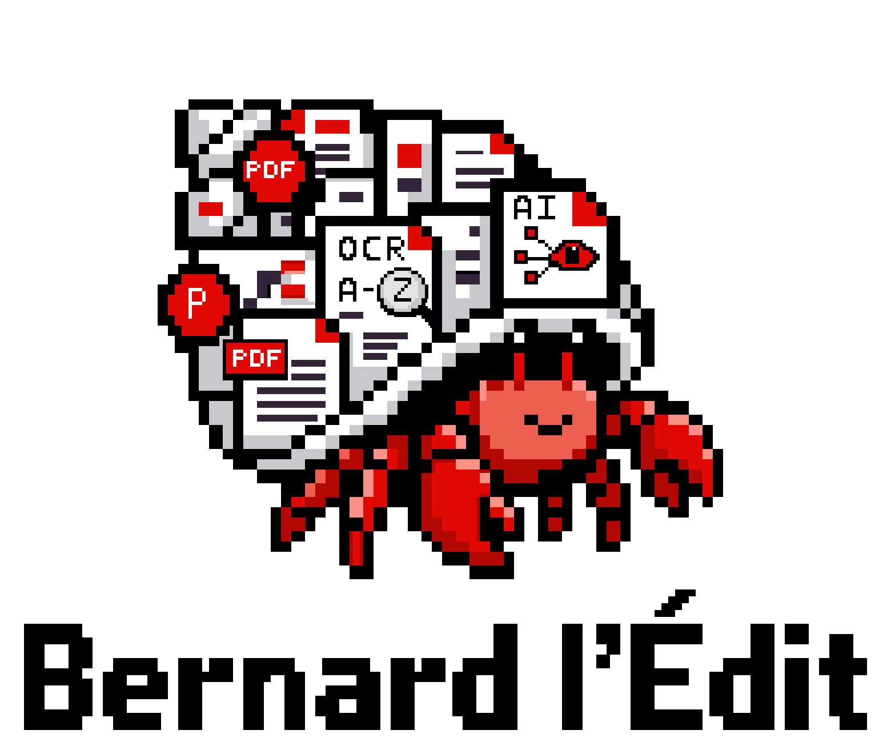

# Bernard l'Édit

<p align="center">
  
</p>

> PDF, image, and geometry utilities for the Mindee SDK ecosystem.

Bernard l'Édit is a **Rust core library** with per-language bindings that gives every official Mindee Client Library a
single, high-performance foundation for PDF manipulation, image processing, and geometry operations. It replaces a
patchwork of language-specific dependencies (pypdfium2/Pillow, PDFBox, SkiaSharp, Docnet, origami, Imagick, …) with one
audited implementation.

> ⚠️ **Status:** under heavy development – APIs may change between minor versions.

---

## Table of contents

- [Features](#features)
- [Architecture](#architecture)
- [Python binding](#python-binding)
  - [Installation](#installation)
  - [Image API](#image-api)
  - [PDF API](#pdf-api)
  - [Geometry API](#geometry-api-deprecated)
- [PHP binding](#php-binding)
- [PDFium: dynamic and static builds](#pdfium-dynamic-and-static-builds)
- [Development](#development)
  - [Prerequisites](#prerequisites)
  - [Build](#build)
  - [Test](#test)
  - [Lint](#lint)
  - [CI](#ci)
- [Bindings](#bindings)
- [Thread safety](#thread-safety)
- [License](#license)

---

## Features

| Area         | Capabilities                                                                                                                                                                                        |
| ------------ | --------------------------------------------------------------------------------------------------------------------------------------------------------------------------------------------------- |
| **Image**    | Decode (JPEG, PNG, TIFF, WebP, BMP, GIF, …), crop, resize, encode, compress to JPEG, save to path or buffer, extract polygon crops from images and PDF pages                                         |
| **PDF**      | Load, split, merge, rasterise pages to images, embed images, extract text and character metadata, compress scans, extract sub-documents, apply page options, repair broken headers |
| **Geometry** | Point and polygon primitives, currently not in use.                                                                                                                                                 |

---

## Architecture

```
bernard-ledit/
├── core/                   # Rust library (bernard-ledit crate)
│   ├── pdfium-release      # Pinned PDFium release (pdfium-binaries tag)
│   ├── build.rs            # Fetches the dynamic PDFium for development builds
│   └── src/
│       ├── image/          # Image decoding, encoding, compression, polygon crops
│       ├── pdf/            # PDF manipulation via PDFium
│       ├── geometry/       # Point / Polygon primitives
│       └── utils/
├── bindings/
│   ├── python/             # PyO3 extension (maturin)
│   ├── php/                # PHP extension (ext-php-rs)
│   ├── java/
│   ├── dotnet/
│   ├── nodejs/
│   └── ruby/
├── tools/
│   └── pdfium-static/      # Builds and downloads static PDFium libraries
└── .github/workflows/      # CI, see below
```

The Rust core is the single source of truth. Language bindings are thin wrappers that convert types and errors and
expose the same API idiomatically in each language.

---

## Python binding

### Installation

```bash
pip install bernard-ledit
```

The wheel bundles the compiled Rust extension and pdfium – no system dependencies required.

### Image API

```python
import io
from pathlib import Path

from bernard_ledit.common import format_from_extension
from bernard_ledit.image import Image, guess_format

# --- load ---
# Accepts bytes or any binary file-like object (BytesIO, BufferedReader, …)
img = Image(open("photo.jpg", "rb"))
img = Image(b"\xff\xd8\xff...")
print(img)  # Image(1920x1080, format:JPEG)
print(img.size)  # (1920, 1080)
print(img.format)  # 'JPEG'

# --- transform (both return a new Image) ---
cropped = img.crop(left=0, top=0, right=960, bottom=540)
resized = img.resize(640, 360)  # exact size, Lanczos filter

# --- encode ---
jpeg_bytes = img.encode("JPEG", jpeg_quality=85, jpeg_optimize=True)
png_bytes = img.encode("PNG")
pdf_bytes = img.encode("PDF")  # single-page PDF via DCTDecode
# JPEG Huffman tables are optimized by default; pass jpeg_optimize=False to disable.

# --- save ---
Path("out.jpg").write_bytes(img.encode(format_from_extension("jpg")))
Path("out.png").write_bytes(img.encode(format_from_extension("png")))
buffer = io.BytesIO()
buffer.write(img.encode("JPEG"))
Path("out.pdf").write_bytes(img.encode(format_from_extension("pdf")))

# --- helpers ---
fmt = guess_format(data)  # "JPEG" | "PNG" | "TIFF" | …

# --- compress to JPEG ---
# Re-encodes as JPEG. If dimensions are unchanged and the output isn't smaller
# than the source, raises ImageError.
out = img.compress_to_jpeg(
    quality=85,
    optimize=True,
    max_width=1024,  # aspect-preserving downscale, never upscales
    max_height=1024,
)

# --- crop by polygon ---
# Polygon points are normalized (x, y) coordinates (0..1).
crop = img.crop_polygon([(0.1, 0.1), (0.5, 0.1), (0.5, 0.4), (0.1, 0.4)])
Path("crop.jpg").write_bytes(crop.encode(format_from_extension("jpg")))
```

Supported encode formats: `JPEG`, `PNG`, `PDF`, `TIFF`, `WEBP`, `BMP`, `GIF`, `AVIF`, `ICO`, `QOI`, `TGA`, `PNM`,
`FARBFELD`, `OPENEXR`.

### PDF API

```python
from bernard_ledit.pdf import PdfDocument

# --- load ---
doc = PdfDocument(open("document.pdf", "rb"))  # also accepts bytes or path
doc = PdfDocument(b"...")
doc = PdfDocument("/path/to/file.pdf")

# context-manager (auto-close)
with PdfDocument("document.pdf") as doc:
    print(len(doc))  # page count
    page = doc[0]  # or doc.get_page(0)
    print(page.text())  # extracted text
    image = page.render(scale=2.0)  # Image at 2× scale
    png_bytes = image.encode("PNG")

# --- rasterise a page to an image ---
rasterized_image = doc.rasterize_page(page_index=0)
jpeg_bytes = rasterized_image.encode("JPEG", jpeg_quality=85)

# --- split / merge ---
a = PdfDocument("a.pdf")
b = PdfDocument("b.pdf")
out = PdfDocument.new()
out.import_pages(a, [0, 1])
out.import_pages(b, [0])

buf = io.BytesIO()
buf.write(out.as_bytes())

```

```python
from bernard_ledit.pdf import (
    PdfDocument, compress_to_jpeg, extract_from_page_ranges, fix_pdf, apply_page_options,
)

# --- compress to JPEG ---
# Only pages without a text layer (scans) are rasterised and re-encoded as JPEG.
# Returns the input unchanged if the result would not be smaller.
smaller = compress_to_jpeg(pdf_bytes, quality=85, optimize=True, dpi=150.0)
# The method form returns a new PdfDocument, or None when there is nothing to gain.
with PdfDocument(pdf_bytes) as doc:
    result = doc.compress_to_jpeg(quality=85, optimize=True, dpi=150.0)

# --- extract sub-documents ---
# `data` is a PDF or an image (treated as a one-page document).
# Page indexes are 0-based; returns one PdfDocument per group.
parts = extract_from_page_ranges(pdf_bytes, [[0, 1], [4]])

# --- keep or remove pages ---
# `operation` is "KEEP_ONLY" or "REMOVE". Negative indexes count from the end.
# Returns (document or None, skipped_indexes). None means the PDF has fewer
# than `on_min_pages` pages, so nothing was done.
doc, skipped = apply_page_options(
    pdf_bytes, operation="KEEP_ONLY", on_min_pages=0, page_indexes=[0, -1]
)

# --- repair a broken header ---
# Drops every byte before the first `%PDF-` marker, if it sits before maximum_offset.
fixed = fix_pdf(raw_bytes, maximum_offset=500)
```

### Geometry API [DEPRECATED]

```python
from bernard_ledit.geometry import Point, Polygon

p = Point(0.5, 0.75)
print(p.x, p.y)  # 0.5  0.75

poly = Polygon([(0, 0), (1, 0), (1, 1), (0, 1)])
print(poly.centroid())  # Point(0.5, 0.5)
print(len(poly))  # 4
```

---

## PHP binding

The PHP extension (`bindings/php`, built with [ext-php-rs](https://github.com/davidcole1340/ext-php-rs)) exposes the
same PDF and image API as the Python binding, and is used by
the [Mindee PHP SDK](https://github.com/mindee/mindee-api-php). Its PHP API is documented by the IDE / PHPStan stubs
in [`bindings/php/bernard_ledit.stubs.php`](bindings/php/bernard_ledit.stubs.php), regenerated with `just php stubs`.

**Supported:** PHP 8.1 – 8.5, ZTS and NTS, on Linux (x86_64 and arm64, glibc and musl), macOS (arm64 and x86_64) and
Windows (x86_64). Released extensions link PDFium statically: they are a single file with no PDFium to install. The
Linux glibc builds require glibc 2.35 or newer.

### Installation

Installation through [PIE](https://github.com/php/pie) (`pie install mindee/bernard-ledit`) is coming with the first PHP
release. Until then, build it from source:

```bash
# Download the static PDFium for your platform (see the targets table below)
bash tools/pdfium-static/download.sh linux-x64-glibc "$PWD/.pdfium-static"
export PDFIUM_STATIC_LIB_PATH="$PWD/.pdfium-static"

# Build and test the release extension with PDFium linked in
just php test-static
```

The extension is then in `target/release/` (`libbernard_ledit_php.so`, `.dylib` on macOS, `bernard_ledit_php.dll` on
Windows); load it with `extension=/path/to/it` in your `php.ini`.

On Windows, build with Rust nightly (`RUSTUP_TOOLCHAIN=nightly`, required by ext-php-rs) and with the MSVC toolset your
PHP was built with: 14.29 (v142) for PHP 8.1 – 8.3, 14.44 (v143) for 8.4 and 8.5, downloading the matching
`win-x64-v142` or `win-x64-v143` library.

---

## PDFium: dynamic and static builds

PDFium comes from [bblanchon/pdfium-binaries](https://github.com/bblanchon/pdfium-binaries), at the release pinned in [
`core/pdfium-release`](core/pdfium-release). Builds use it in one of two ways:

|                   | Dynamic (default)                                                                                                       | Static                                                                                                                                        |
| ----------------- | ----------------------------------------------------------------------------------------------------------------------- | --------------------------------------------------------------------------------------------------------------------------------------------- |
| **Used for**      | Development and tests                                                                                                   | Released packages                                                                                                                             |
| **How**           | `core/build.rs` downloads the shared library into `core/.pdfium_cache`; the binding loads it at runtime (`PDFIUM_PATH`) | PDFium is linked into the binding at build time: `PDFIUM_STATIC_LIB_PATH` points to the library, and a static feature selects the C++ runtime |
| **Cargo feature** | none                                                                                                                    | `static-pdfium` (Linux, libstdc++), `static-pdfium-libcxx` (macOS, libc++), `static-pdfium-msvc` (Windows)                                    |

Static libraries are prebuilt by [`build-static-pdfium.yml`](.github/workflows/build-static-pdfium.yml) and published,
each with a `.sha256` checksum, to the `pdfium-static-<release>` GitHub release of this repository (e.g.
`pdfium-static-chromium_8076`). Each target's archive is published with its corresponding license bundle.

| Target              | For                                        |
| ------------------- | ------------------------------------------ |
| `linux-x64-glibc`   | Linux x86_64, glibc 2.35+                  |
| `linux-arm64-glibc` | Linux arm64, glibc 2.35+                   |
| `linux-x64-musl`    | Alpine x86_64                              |
| `linux-arm64-musl`  | Alpine arm64                               |
| `mac-arm64`         | macOS, Apple Silicon                       |
| `mac-x64`           | macOS, Intel                               |
| `win-x64-v142`      | Windows x86_64, MSVC 14.29 (PHP 8.1 – 8.3) |
| `win-x64-v143`      | Windows x86_64, MSVC 14.44 (PHP 8.4, 8.5)  |
| `win-arm64-v143`    | Windows arm64, MSVC 14.44                  |

```bash
# Download a published library (needs an authenticated `gh`)
bash tools/pdfium-static/download.sh <target> <directory>

# Or build one yourself (Linux: needs Docker; Windows: also set MSVC_TOOLSET, e.g. 14.44)
PDFIUM_OS=linux PDFIUM_CPU=x64 bash tools/pdfium-static/build.sh
```

`build.sh` documents its other settings (musl, work and output directories) in its header. The target list lives in [
`tools/pdfium-static/targets.json`](tools/pdfium-static/targets.json).

---

## Development

### Prerequisites

| Tool                                                     | Purpose                                     |
| -------------------------------------------------------- | ------------------------------------------- |
| Rust 1.99.0 (pinned in `rust-toolchain.toml`)            | Core + all bindings                         |
| Rust nightly                                             | PHP binding on Windows only (ext-php-rs)    |
| [just](https://github.com/casey/just)                    | Task runner                                 |
| A C compiler + cmake + nasm                              | Building static PDFium libraries            |
| [maturin](https://github.com/PyO3/maturin)               | Build Python wheels                         |
| Python ≥ 3.9 + virtualenv                                | Python binding tests                        |
| PHP ≥ 8.1 with its dev headers (`php-config`) + Composer | PHP binding build and tests                 |
| libclang                                                 | PHP binding (ext-php-rs generates bindings) |
| [GitHub CLI](https://cli.github.com/)                    | Downloading static PDFium libraries         |
| Docker                                                   | Building static PDFium for Linux            |

### Build

```bash
# Rust core (release)
just core build

# Python extension (installs into the active virtualenv)
just python build

# PHP extension: debug with dynamic PDFium, or release with PDFium linked in
just php build
just php build-static      # needs PDFIUM_STATIC_LIB_PATH
```

### Test

```bash
# Rust core
just core test
just core hack-test        # every feature combination, except the static-linking ones

# Python binding (builds extension first if needed)
just python test

# PHP binding
just php test              # debug build, dynamic PDFium
just php test-static       # release build, PDFium linked in, no PDFium library on disk
just php smoke             # checks that the extension loads
```

> **Note:** Rust tests run single-threaded (`RUST_TEST_THREADS=1` via `.cargo/config.toml`) because pdfium's renderer is
> not thread-safe.

### Lint

```bash
just core lint             # fmt-check + clippy + cargo-deny + udeps + feature-powerset check
just core check-all        # everything: fmt + lint + build + test
just php lint              # clippy on the PHP binding
just php stubs-check       # fails if the committed PHP stubs are out of date
```

### CI

| Workflow                           | What it does                                                                                                              |
| ---------------------------------- | ------------------------------------------------------------------------------------------------------------------------- |
| `pull-request.yml`, `main-dev.yml` | Entry points: run the unit tests, binding tests and linters                                                               |
| `build-static-pdfium.yml`          | Builds and publishes any missing static PDFium library, then runs `_php-static-check.yml` against the published libraries |
| `_php-static-check.yml`            | Builds and tests the PHP extension with static PDFium: PHP 8.1 – 8.5, ZTS and NTS, on every target with a PHP build       |

---

## Bindings

| Language | Crate / Package        | Status                                             |
| -------- | ---------------------- | -------------------------------------------------- |
| Python   | `bernard-ledit` (PyPI) | ✅ Active                                          |
| PHP      | `bindings/php`         | ✅ Active, used by the PHP SDK; PIE release coming |
| Java     | `bindings/java`        | 🚧 In progress (geometry)                          |
| .NET     | `bindings/dotnet`      | 🚧 In progress                                     |
| Node.js  | `bindings/nodejs`      | 🚧 In progress                                     |
| Ruby     | `bindings/ruby`        | 🚧 In progress                                     |

---

## Thread safety

PDFium rendering calls are serialized by a process-wide mutex.
The Python GIL additionally protects single-threaded callers.

**Safe:** single-threaded Python, Python `threading` (GIL held in Rust), separate `multiprocessing` workers.  
**Avoid:** `os.fork()` after a `PdfDocument` has been opened in the parent process.

---

## License

Apache 2.0 – see [LICENSE](LICENSE).
