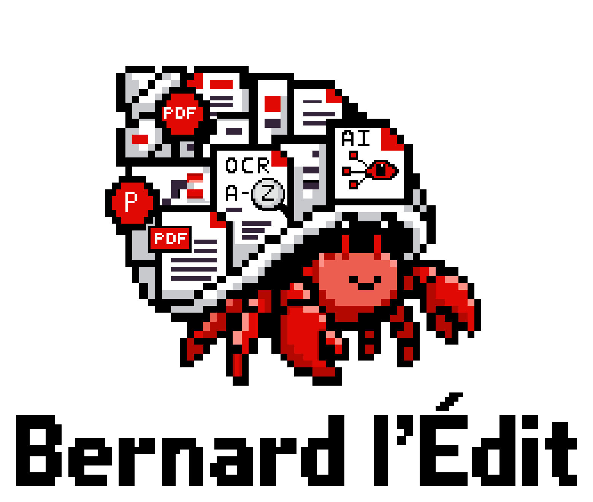

# Bernard l'Édit

<p align="center">
  
</p>

> PDF, image, and geometry utilities for the Mindee SDK ecosystem.

Bernard l'Édit is a **Rust core library** with per-language bindings that gives every official Mindee Client Library a single, high-performance foundation for PDF manipulation, image processing, and geometry operations. It replaces a patchwork of language-specific dependencies (pypdfium2/Pillow, PDFBox, SkiaSharp, Docnet, origami, Imagick, …) with one audited implementation.

> ⚠️ **Status:** under heavy development – APIs may change between minor versions.

---

## Table of contents

- [Features](#features)
- [Architecture](#architecture)
- [Python binding](#python-binding)
  - [Installation](#installation)
  - [Image API](#image-api)
  - [PDF API](#pdf-api)
  - [Geometry API](#geometry-api)
- [Development](#development)
  - [Prerequisites](#prerequisites)
  - [Build](#build)
  - [Test](#test)
  - [Lint](#lint)
- [Bindings](#bindings)
- [Thread safety](#thread-safety)
- [Third-party notices](#third-party-notices)
- [License](#license)

---

## Features

| **Image** | Decode (JPEG, PNG, TIFF, WebP, BMP, GIF, …), crop, resize, encode, compress, save to path or buffer, extract polygon crops from images and PDF pages |
| **PDF** | Load, split, merge, rasterise pages to JPEG, embed images, extract text and character metadata, add text overlays, compress scans, extract sub-documents, apply page options, repair broken headers |

---

## Architecture

```
bernard-ledit/
├── core/                   # Rust library (bernard-ledit crate)
│   └── src/
│       ├── image/          # Image decoding, encoding, compression
│       ├── pdf/            # PDF manipulation via pdfium
│       └── geometry/       # Point / Polygon primitives
└── bindings/
    ├── python/             # PyO3 extension (maturin)
    ├── dotnet/
    ├── java/
    ├── nodejs/
    ├── php/
    └── ruby/
```

The Rust core is the single source of truth. Language bindings are thin wrappers that expose the same API idiomatically in each language.

---

## Python binding

### Installation

The Python package is not currently published on PyPI, so `pip install bernard-ledit` will not work. To use it, build the binding from a checkout by following the [Building](#building) instructions below.

### Image API

```python
from bernard_ledit.image import Image, guess_format, compress, extract_from_polygons

# --- load ---
# Accepts bytes or any binary file-like object (BytesIO, BufferedReader, …)
img = Image(open("photo.jpg", "rb"))
img = Image(b"\xff\xd8\xff...")
print(img)           # Image(1920x1080, format:JPEG)
print(img.size)      # (1920, 1080)
print(img.format)    # 'JPEG'

# --- transform (both return a new Image) ---
cropped = img.crop(left=0, top=0, right=960, bottom=540)
resized = img.resize(640, 360)                     # exact size, Lanczos filter

# --- encode ---
jpeg_bytes = img.encode("JPEG", quality=85)        # optimize=True by default (mozjpeg)
png_bytes  = img.encode("PNG")
pdf_bytes  = img.encode("PDF")                     # single-page PDF via DCTDecode

# --- save ---
img.save("out.jpg")                    # format inferred from extension
img.save(pathlib.Path("out.png"))
img.save(buffer, format="JPEG")        # write to any writable buffer
img.save("out.pdf", format="PDF")      # force PDF regardless of extension

# --- helpers ---
fmt = guess_format(data)               # "JPEG" | "PNG" | "TIFF" | …

# --- compress ---
# Re-encodes as JPEG and returns bytes. If the result would not be smaller than
# the input (and no downscale was requested), the input is returned unchanged.
out = compress(
    data,
    quality=85,
    max_width=1024,    # aspect-preserving downscale, never upscales
    max_height=1024,
    optimize=True,
)
# The method form returns None instead when there is nothing to gain.
out = Image(data).compress(quality=85)

# --- extract crops ---
# `data` is an image or a PDF. Polygons are lists of normalized (x, y) points (0..1);
# each crop is the polygon's bounding box. Returns one Image per polygon.
crops = extract_from_polygons(
    data,
    page_id=0,
    polygons=[[(0.1, 0.1), (0.5, 0.1), (0.5, 0.4), (0.1, 0.4)]],
    dpi=72.0,          # PDF rendering resolution
)
crops[0].save("crop.jpg")
```

Supported encode formats: `JPEG`, `PNG`, `PDF`, `TIFF`, `WEBP`, `BMP`, `GIF`, `AVIF`, `ICO`, `QOI`, `TGA`, `PNM`, `FARBFELD`, `OPENEXR`.

### PDF API

```python
from bernard_ledit.pdf import PdfDocument

# --- load ---
doc = PdfDocument(open("document.pdf", "rb"))  # also accepts bytes or path
doc = PdfDocument(b"...")
doc = PdfDocument("/path/to/file.pdf")

# context-manager (auto-close)
with PdfDocument("document.pdf") as doc:
    print(len(doc))           # page count
    page = doc[0]             # or doc.get_page(0)
    print(page.get_size())    # PageSize(width=595.0, height=842.0)
    print(page.text())        # extracted text
    print(page.chars())       # list[TextChar] with font/bounds metadata
    print(page.rotation())    # 0 | 90 | 180 | 270
    bitmap = page.render_to_bitmap(scale=2.0)   # PdfBitmap at 2× scale (was page.render)
    png_bytes = bitmap.to_png_bytes()

# --- rasterise a page to JPEG ---
jpeg_bytes = doc.rasterize_page(page_index=0, quality=85)

# --- split / merge ---
a = PdfDocument("a.pdf")
b = PdfDocument("b.pdf")
out = PdfDocument.new()
out.import_pages(a, [0, 1])
out.import_pages(b, [0])

buf = io.BytesIO()
out.save(buf)
out.save_to_file("merged.pdf")

# --- embed images ---
doc = PdfDocument.new()
doc.append_jpeg_page(jpeg_bytes)
doc.append_multiple_jpeg_pages([jpeg1, jpeg2])

# --- overlay text ---
from bernard_ledit.pdf import TextChar
chars = [TextChar(char="A", font_name="Helvetica", font_size=12.0,
                  font_weight=400, bounds=(50.0, 100.0, 62.0, 112.0))]
doc.add_text(page_idx=0, chars=chars)
```

```python
from bernard_ledit.pdf import (
    PdfDocument, compress, extract_from_page_ranges, fix_pdf, apply_page_options,
)

# --- compress ---
# Only pages without a text layer (scans) are rasterised and re-encoded as JPEG.
# Returns the input unchanged if the result would not be smaller.
smaller = compress(pdf_bytes, quality=85, optimize=True, dpi=150.0)
# The method form returns a new PdfDocument, or None when there is nothing to gain.
with PdfDocument(pdf_bytes) as doc:
    result = doc.compress(quality=85)

# --- extract sub-documents ---
# `data` is a PDF or an image (treated as a one-page document).
# Page indexes are 0-based; returns one PdfDocument per group.
parts = extract_from_page_ranges(pdf_bytes, [[0, 1], [4]])

# --- keep or remove pages ---
# `operation` is "KEEP_ONLY" or "REMOVE". Negative indexes count from the end.
# Returns (document or None, skipped_indexes). None means the PDF has fewer
# than `on_min_pages` pages, so nothing was done.
doc, skipped = apply_page_options(
    pdf_bytes, operation="KEEP_ONLY", on_min_pages=0, page_indexes=[0, -1]
)

# --- repair a broken header ---
# Drops every byte before the first `%PDF-` marker, if it sits before maximum_offset.
fixed = fix_pdf(raw_bytes, maximum_offset=500)
```

### Geometry API [DEPRECATED]

```python
from bernard_ledit.geometry import Point, Polygon

p = Point(0.5, 0.75)
print(p.x, p.y)    # 0.5  0.75

poly = Polygon([(0, 0), (1, 0), (1, 1), (0, 1)])
print(poly.centroid())   # Point(0.5, 0.5)
print(len(poly))         # 4
```

---

## Development

### Prerequisites

| Tool                                          | Purpose                              |
| --------------------------------------------- | ------------------------------------ |
| Rust 1.99.0 (pinned in `rust-toolchain.toml`) | Core + all bindings                  |
| [just](https://github.com/casey/just)         | Task runner                          |
| [maturin](https://github.com/PyO3/maturin)    | Build Python wheels                  |
| A C compiler + cmake                          | mozjpeg (bundled, built from source) |
| Python ≥ 3.9 + virtualenv                     | Python binding tests                 |

### Build

```bash
# Rust core (debug)
just build

# Python extension (installs into the active virtualenv)
just python build
```

### Test

```bash
# Rust core
just test

# Python binding (builds extension first if needed)
just python test
```

> **Note:** Rust tests run single-threaded (`RUST_TEST_THREADS=1` via `.cargo/config.toml`) because pdfium's renderer is not thread-safe.

### Lint

```bash
just lint          # fmt-check + clippy + cargo-deny + udeps
just check         # everything: fmt + lint + build + test
```

---

## Bindings

| Language | Crate / Package   | Status                  |
| -------- | ----------------- | ----------------------- |
| Python   | `bernard-ledit`   | ✅ Active (source only) |
| .NET     | `bindings/dotnet` | 🚧 In progress          |
| Java     | `bindings/java`   | 🚧 In progress          |
| Node.js  | `bindings/nodejs` | 🚧 In progress          |
| PHP      | `bindings/php`    | 🚧 In progress          |
| Ruby     | `bindings/ruby`   | 🚧 In progress          |

---

## Thread safety

All pdfium rendering and mozjpeg encoding calls are serialized behind process-wide mutexes.
The Python GIL additionally protects single-threaded callers.

**Safe:** single-threaded Python, Python `threading` (GIL held in Rust), separate `multiprocessing` workers.  
**Avoid:** `os.fork()` after a `PdfDocument` has been opened in the parent process.

---

## Third-party notices

This distribution bundles mozjpeg (libjpeg-turbo + IJG). See [THIRD_PARTY_NOTICES](THIRD_PARTY_NOTICES) for the full attribution text required by their licenses.

---

## License

Apache 2.0 – see [LICENSE](LICENSE).
