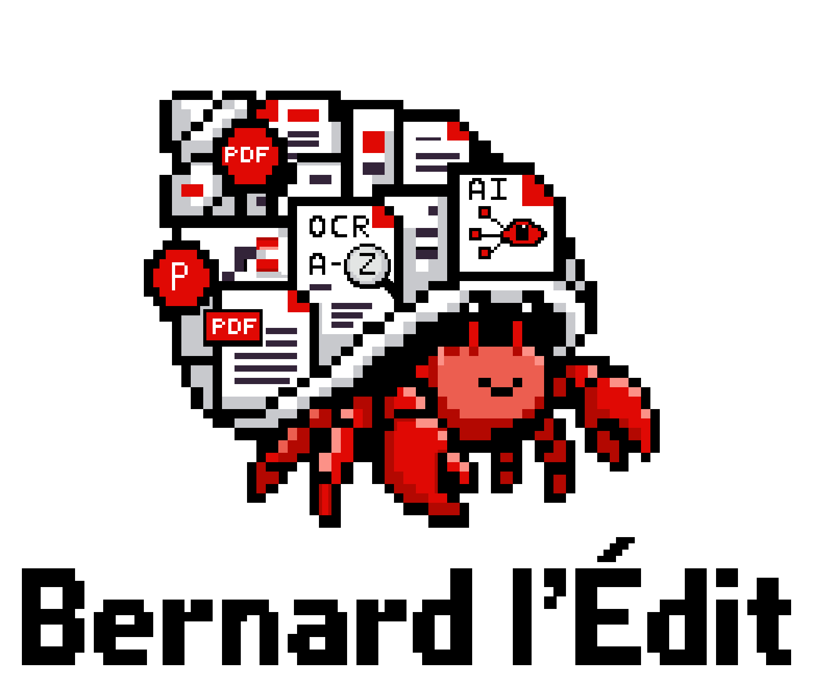

# Bernard l'Édit

<p align="center">
  
</p>

> PDF and image utilities with multiple languages bindings.

> ⚠️ **Status:** under heavy development – APIs may change between minor versions.

---

## Table of contents

- [Features](#features)
- [Architecture](#architecture)
- [Overview](#overview)
- [Bindings](#bindings)
- [Native libheif prerequisites](#native-libheif-prerequisites)
- [PDFium builds](#pdfium-builds)
- [Development](#development)
  - [Prerequisites](#prerequisites)
  - [Build](#build)
  - [Test](#test)
  - [Lint](#lint)
  - [CI](#ci)
- [Thread safety](#thread-safety)
- [License](#license)

---

## Features

| Area         | Capabilities                                                                                                                                                                                        |
| ------------ | --------------------------------------------------------------------------------------------------------------------------------------------------------------------------------------------------- |
| **Image**    | Decode (JPEG, PNG, TIFF, WebP, BMP, GIF, HEIC, HEIF …), crop, resize, encode, compress to JPEG, extract polygon crops from images and PDF pages                                         |
| **PDF**      | Load, split, merge, rasterise pages to images, embed images, extract text and character metadata, compress scans, extract sub-documents, apply page options, repair broken headers |

---

## Architecture

```
bernard-ledit/
├── core/                   # Rust library (bernard-ledit crate)
│   ├── pdfium-release      # Pinned PDFium release (pdfium-binaries tag)
│   └── src/
│       ├── image/          # Image decoding, encoding, compression, polygon crops
│       ├── pdf/            # PDF manipulation via PDFium
│       └── utils/
├── bindings/
│   ├── python/             # PyO3 extension (maturin)
│   ├── php/                # PHP extension (ext-php-rs)
│   ├── java/
│   ├── dotnet/
│   ├── nodejs/
│   └── ruby/
├── tools/
│   └── pdfium-static/      # Builds and downloads static PDFium libraries
└── .github/workflows/      # CI, see below
```

---

## Overview

Bernard-Ledit uses:
1. pdfium for PDF manipulation
2. jpeg-encoder to compress using JPEG
3. libheif for HEIC/HEIF image decoding
4. image for general image decoding, encoding, and manipulation

Supported encode formats: `JPEG`, `PNG`, `PDF`, `TIFF`, `WEBP`, `BMP`, `GIF`, `AVIF`, `ICO`, `QOI`, `TGA`, `PNM`,
`FARBFELD`, `OPENEXR`.

HEIC support is decode-only; HEIC encoding is unsupported. See
[image formats](docs/image-formats.md) for the scope and current status.

## Bindings

The Python binding is the reference for the other bindings, which follow its API and documentation
structure while using conventions appropriate to their language.

| Language | Crate / Package        | Status                                             |
| -------- | ---------------------- | -------------------------------------------------- |
| [Python](bindings/python/README.md) | `bernard-ledit` (PyPI) | ✅ Active |
| [PHP](bindings/php/README.md) | `bindings/php` | ✅ Active, used by the PHP SDK; PIE release coming |
| [Java](bindings/java/README.md) | `bindings/java` | 🚧 In progress |
| [.NET](bindings/dotnet/README.md) | `bindings/dotnet` | 🚧 In progress |
| [Node.js](bindings/nodejs/README.md) | `bindings/nodejs` | 🚧 In progress |
| [Ruby](bindings/ruby/README.md) | `bindings/ruby` | 🚧 In progress |

---

## Native libheif prerequisites

Requires **system libheif 1.17+ with at least one HEVC decoder plugin**: libde265 or
FFmpeg.
Rust builds need development headers;
applications need the compatible shared library and decoder plugin at runtime.
Neither libheif nor its plugins are bundled in the Python or PHP packages.
An HEVC encoder is not required.

| Platform | Installation |
| --- | --- |
| Ubuntu 24.04 | `sudo apt-get install pkg-config libheif-dev libheif-plugin-libde265` (you can replace `libheif-plugin-libde265` `with `libheif-plugin-ffmpegdec`). |
| macOS | `brew install libheif` |
| Windows x64 MSVC | Install vcpkg's dynamic `libheif[core,libde265]:x64-windows`, set `VCPKG_ROOT` and `VCPKGRS_DYNAMIC=1` for builds, and make its DLLs available at runtime. |

---

## PDFium builds

All core and binding builds link PDFium statically. Cargo looks for the target's `libpdfium.a`
(or `pdfium.lib` on Windows) in `.pdfium-static/` at the repository root. The pinned PDFium version
is in [`core/pdfium-release`](core/pdfium-release).

Static libraries are prebuilt by [`build-static-pdfium.yml`](.github/workflows/build-static-pdfium.yml) and published,
each with a `.sha256` checksum, to the `pdfium-static-<release>` GitHub release of this repository (e.g.
`pdfium-static-chromium_8076`). Each target's archive is published with its corresponding license bundle.

| Target              | For                                        |
| ------------------- | ------------------------------------------ |
| `linux-x64-glibc`   | Linux x86_64, glibc 2.35+                  |
| `linux-arm64-glibc` | Linux arm64, glibc 2.35+                   |
| `linux-x64-musl`    | Alpine x86_64                              |
| `linux-arm64-musl`  | Alpine arm64                               |
| `mac-arm64`         | macOS, Apple Silicon                       |
| `mac-x64`           | macOS, Intel                               |
| `win-x64-v142`      | Windows x86_64, MSVC 14.29 (PHP 8.1 – 8.3) |
| `win-x64-v143`      | Windows x86_64, MSVC 14.44 (PHP 8.4, 8.5)  |
| `win-arm64-v143`    | Windows arm64, MSVC 14.44                  |

```bash
# Download a published library (needs an authenticated `gh`)
bash tools/pdfium-static/download.sh <target>

# Or build one yourself (Linux: needs Docker; Windows: also set MSVC_TOOLSET, e.g. 14.44)
PDFIUM_OS=linux PDFIUM_CPU=x64 OUT_DIR="$PWD/.pdfium-static" bash tools/pdfium-static/build.sh
```

`build.sh` documents its other settings (musl, work and output directories) in its header. The target list lives in [
`tools/pdfium-static/targets.json`](tools/pdfium-static/targets.json).
To use a different archive directory, set `PDFIUM_STATIC_LIB_PATH` before building. When replacing
the archive in the same directory, run `cargo clean -p pdfium-render` so Cargo rebuilds it.

---

## Development

### Prerequisites

| Tool                                                     | Purpose                                     |
| -------------------------------------------------------- | ------------------------------------------- |
| Rust 1.99.0 (pinned in `rust-toolchain.toml`)            | Core + all bindings                         |
| [just](https://github.com/casey/just)                    | Task runner                                 |
| System libheif ≥ 1.17 + one HEVC decoder plugin (libde265 or FFmpeg), development files | HEIC decoder in core and bindings |


### Build

```bash
# Rust core (release)
just core build
```

### Test

```bash
# Rust core
just core test
just core test-release     # release mode
```

### Lint

```bash
just core lint             # fmt-check + clippy + cargo-deny + udeps + cargo check
just core check-all        # everything: fmt + lint + build + debug/release tests
```

---

## Thread safety

PDFium rendering calls are serialized by a process-wide mutex.
See the [Python binding](bindings/python/README.md#thread-safety) for Python-specific guidance.

---

## License

Apache 2.0 – see [LICENSE](LICENSE).